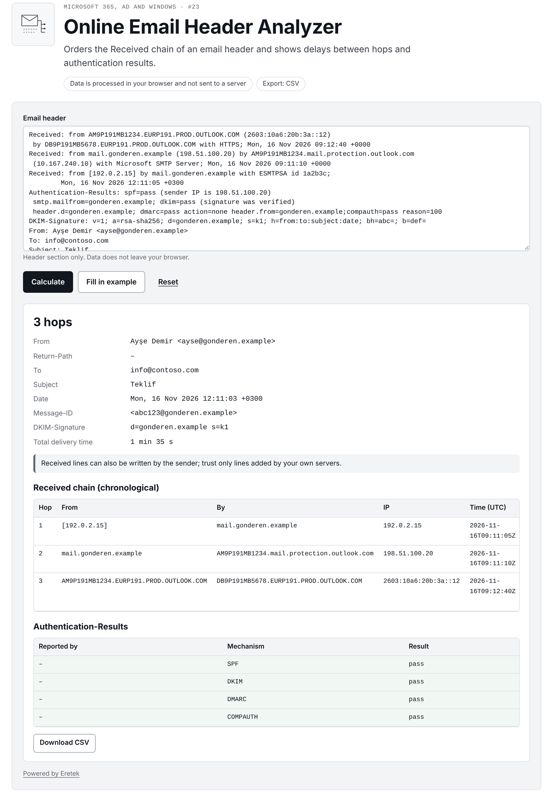

# Email Header Analyzer

Paste an email header to see the Received chain, delays between servers, SPF/DKIM/DMARC results and DKIM signature details. Body and attachments are not needed.

## Try it live

- [Türkçe](https://sistem.eretek.com/araclar/eposta-header-analizi)
- [English](https://sistem.eretek.com/en/tools/email-header-analyzer)
- [Deutsch](https://sistem.eretek.com/de/werkzeuge/e-mail-header-analyse)



## What it does

Orders the Received chain of an email header and shows delays between hops and authentication results.

The story of a late, spam-filtered or suspicious email is in its headers, but they come in reverse order, with folded lines and different time zones. The tool puts the Received lines in chronological order, calculates the time between hops in UTC and tabulates the Authentication-Results.

## Where it helps

The hop with the large delay shows which server is the problem. A negative delay means that server's clock is wrong (check NTP).

If authentication fails, check the sending domain with the SPF Record Checker and DKIM Selector Lookup.

## How to use it

1. Open the original header in your mail client (Outlook: File › Properties › Internet headers; Gmail: Show original) and paste the header section.
2. Do not add the body; anything after the first blank line is ignored. Press Calculate.

### Fields

| Field | Description |
|---|---|
| Email header | Header section only. Data does not leave your browser. |

## Example input

Press **Fill in example** in the tool to load this input.

**Email header**

```text
Received: from AM9P191MB1234.EURP191.PROD.OUTLOOK.COM (2603:10a6:20b:3a::12)
 by DB9P191MB5678.EURP191.PROD.OUTLOOK.COM with HTTPS; Mon, 16 Nov 2026 09:12:40 +0000
Received: from mail.gonderen.example (198.51.100.20) by AM9P191MB1234.mail.protection.outlook.com
 (10.167.240.10) with Microsoft SMTP Server; Mon, 16 Nov 2026 09:11:10 +0000
Received: from [192.0.2.15] by mail.gonderen.example with ESMTPSA id 1a2b3c;
	Mon, 16 Nov 2026 12:11:05 +0300
Authentication-Results: spf=pass (sender IP is 198.51.100.20)
 smtp.mailfrom=gonderen.example; dkim=pass (signature was verified)
 header.d=gonderen.example; dmarc=pass action=none header.from=gonderen.example;compauth=pass reason=100
DKIM-Signature: v=1; a=rsa-sha256; d=gonderen.example; s=k1; h=from:to:subject:date; bh=abc=; b=def=
From: Ayşe Demir <ayse@gonderen.example>
To: info@contoso.com
Subject: Teklif
Date: Mon, 16 Nov 2026 12:11:03 +0300
Message-ID: <abc123@gonderen.example>
```

**Expected result:** 3 hops: the sending server 5 s after the client, then Microsoft's edge server 1 min 30 s later; SPF, DKIM and DMARC pass.

## Method and assumptions

Header lines are unfolded per RFC 5322 (lines starting with whitespace continue the previous header). Received headers are prepended by each server, so they are ordered bottom to top.

The date after the last `;` of each Received line is parsed with its time zone and converted to UTC. The delay is the difference between consecutive hops; a negative value indicates clock skew.

spf, dkim, dmarc, arc and compauth results are read from Authentication-Results; d= and s= from DKIM-Signature.

## Limits and common mistakes

- Received headers can be added by the sender; the lower part of the chain (before your own servers) cannot be verified.
- It does not replace Microsoft 365 message trace or server logs.

## Run it locally

The tool is plain HTML, CSS and JavaScript with no build step and no dependencies.

```bash
git clone https://github.com/eretek/email-header-analyzer.git
cd email-header-analyzer
node scripts/serve.js        # or: python3 -m http.server 8080
```

Open <http://127.0.0.1:8080/>. Add `?lang=tr` or `?lang=de` for Turkish or German; without it the page follows the browser language and falls back to English. You can also open `index.html` directly from disk.

Run the tests (Node.js 18 or later):

```bash
node test/run.js    # or: npm test
```

The tests run the tool's own fixtures and the worked examples in all three languages without a browser.

## How it works

All processing happens in your browser. The tool makes no network requests, uses no cookies or browser storage, and does not upload files you select.

No server-side component is needed. The version on the Eretek website renders the same page through a private WordPress plugin; that plugin only produces the page markup and is not part of this repository.

| Path | Purpose |
|---|---|
| `index.html` | Page shell |
| `src/app.js` | Builds the page in Turkish, English or German from `src/data.js` |
| `src/data.js` | Field definitions, examples and all texts in three languages |
| `src/core.js` | Shared runtime: validation, number formats, result rendering, CSV/ICS export |
| `src/tool.js` | The calculation or analysis for this tool |
| `docs/screenshot.png` | Screenshot used in this README |
| `src/tools.css`, `src/page.css` | Styles |
| `test/run.js`, `test/cases.json` | Headless tests |

## License and attribution

This tool is released under the [Eretek Website Attribution License](LICENSE). You may use, modify and redistribute it, including commercially. If you make it available on a website or web application, show a visible, clickable credit linking to https://eretek.com/ on every page where the tool is available, for example:

```html
<a href="https://eretek.com/">Powered by Eretek</a>
```

You may add `rel="nofollow"` to the link. Keep the copyright notice and license text in copies and redistributions.
